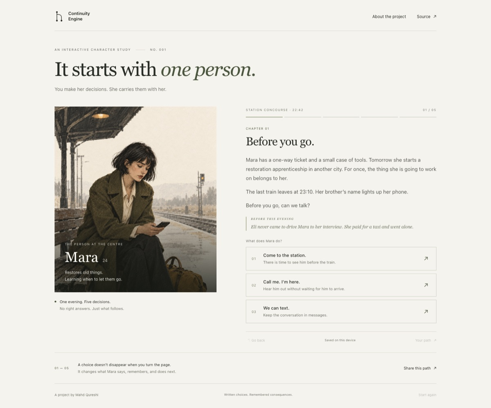

# Continuity Engine

**One character. Five decisions. A story that remembers.**

[Play the story](https://mahd-qureshi.github.io/continuity-engine/)



Mara is about to take the last train out of town. You decide what she does
next. An early choice can return as a remembered detail, change a later
option, or give the ending a different meaning. Rewind to an earlier decision
and follow another path.

The interface keeps the focus on the scene: one character, a short passage,
and a decision. The story is authored. A small deterministic engine carries
its consequences forward.

## Run locally

```sh
python3 -m http.server 4173 --bind 127.0.0.1
```

Open [localhost:4173](http://localhost:4173/). There is no build step,
installation, account, or API key required to play.

## How continuity works

- **Choices become events.** Current story state is rebuilt from the choices
  already made. Replaying the same sequence produces the same result.
- **Earlier decisions matter.** Story conditions select available choices,
  remembered details, and endings from authored content.
- **Rewind changes the future.** Returning to a previous decision keeps its
  preceding history and lets you replace everything that followed it.
- **A session stays local.** Browser storage keeps your place on the device.
  Shared links carry a choice sequence that is validated and replayed.

The engine does not generate prose or call a language model. Its purpose is
to make a small story feel consistent and make that consistency inspectable.

## Source

```text
src/story.js        Mara's scenes, decisions, conditions, and endings
src/continuity.js   deterministic story state and choice replay
src/app.js          browser interface, saved sessions, and sharing
src/styles.css     responsive reading interface
tests/             story and engine checks
docs/experience.md story behavior and implementation boundaries
```

The story and its state logic are separate from browser rendering and storage.
See [experience notes](docs/experience.md) for the interaction and replay model.

## Verify

Node.js 20 or newer is required for the checks.

```sh
npm run verify
```

## Earlier engine experiments

The original orbital-relay experiment remains in `src/engine.js` and
`src/scenario.js`, with validation in `src/validate.js` and replay utilities in
`src/replay.js`. It explores emotional decay, ranked memory retrieval, and
constrained beam search. These modules are preserved as an engine lab;
the Mara experience uses the story engine described above.

```sh
npm run validate     # Validate the original orbital-relay scenario
npm run experiment   # Run the memory-weight sensitivity experiment
node --test tests/engine.test.js tests/validate.test.js tests/replay.test.js tests/property.test.js
```

Read the original [algorithms](docs/algorithms.md),
[architecture](docs/architecture.md), and
[weight-sensitivity study](docs/experiments/weight-sensitivity.md).

## Scope and license

One short authored story, with a finite set of choices and endings. There is
no story editor or open-ended dialogue input. Saved sessions belong to the
current browser; clearing browser storage removes them.

[MIT](LICENSE).
